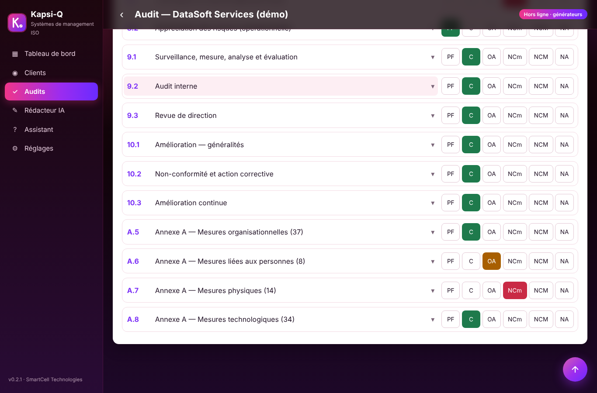
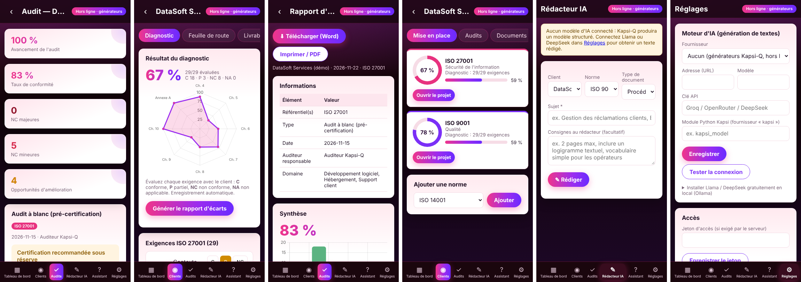
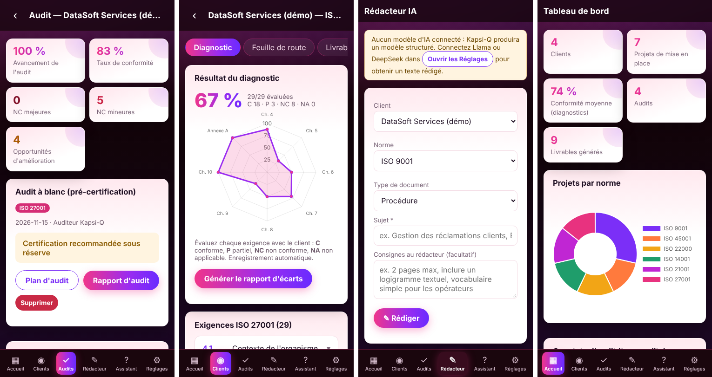

# Rapport de test UI/UX — Kapsi-Q v0.2.2

**Date :** 22 novembre 2026 · **Périmètre :** 14 écrans × 3 tailles d'écran (mobile 375 px, tablette 768 px, bureau 1366 px), soit 42 vues testées.
**Outils :** Playwright (navigateur Chromium automatisé), axe-core 4 (norme d'accessibilité WCAG 2.1 AA), tests clavier, mesure des cibles tactiles et des performances, revue visuelle.

## Résultat global

| Critère | Avant | Après |
|---|---|---|
| Violations d'accessibilité (axe-core, total sur 42 vues) | 53 | **0** |
| Dont critiques (champs sans nom accessible) | 27 | **0** |
| Navigation au clavier (touche Tab) | **Impossible** : le focus restait bloqué | Complète, avec focus visible |
| Cibles tactiles < 32 px sur mobile | 30 | **0** |
| Débordement horizontal | 0 | 0 |
| Erreurs JavaScript | 0 | 0 |
| Affichage du tableau de bord | 0,27 s | 0,23 s |
| Poids total de la page | 261 Ko | 267 Ko (Chart.js inclus, hors ligne) |

## Problèmes trouvés et corrigés

### Bloquants
1. **Navigation au clavier impossible.** Les liens du menu n'avaient pas d'adresse, et les lignes cliquables (clients, audits, documents, projets) n'étaient pas atteignables avec Tab. → Liens réels, éléments cliquables focalisables, activation avec Entrée ou Espace, focus visible (contour rose) et lien « Aller au contenu ».
2. **27 champs de formulaire sans nom accessible** : listes déroulantes et champs illisibles par un lecteur d'écran. → Chaque libellé est relié automatiquement à son champ ; les champs sans libellé reçoivent un nom.

### Majeurs
3. **Contraste insuffisant** des pastilles de normes (orange, ambre, vert, rose) et des boutons de cotation OA/PF (2,8:1 au lieu de 4,5:1). → Les couleurs sont assombries automatiquement jusqu'au niveau WCAG AA, et la palette des cotations a été ajustée.
4. **Boutons imbriqués dans un élément repliable** (grilles de diagnostic et d'audit) : comportement incohérent au clavier et au lecteur d'écran. → Nouvelle structure : bouton d'ouverture séparé (avec ▾), groupe de cotation étiqueté, état « appuyé » annoncé.
5. **Mobile : titres coupés** par le badge IA. → Badge masqué sur mobile.
6. **Mobile : exigences écrasées** par les 6 boutons de cotation. → Les boutons passent sous le titre, en cibles de 44 × 44 px.
7. **Mobile : 5 cartes d'indicateurs empilées une par ligne** (écran d'audit trop long). → Grille de 2 colonnes.
8. **Mobile : 3 listes déroulantes côte à côte** dans le Rédacteur IA (texte tronqué). → Empilées sur mobile.

### Mineurs
9. **Aucune confirmation des enregistrements automatiques.** → Indicateur « ✓ Enregistré » dans l'en-tête, annoncé aux lecteurs d'écran.
10. **Libellé « Tableau de bord » trop long** dans la barre mobile. → « Accueil » sur mobile.
11. **Tableaux défilants inaccessibles au clavier.** → Zones focalisables et nommées.
12. **Impression / PDF** : menu et boutons imprimés. → Feuille de style d'impression dédiée.
13. **L'élément actif du menu perdait son dégradé au survol.** → Corrigé.

## Ajout demandé : bouton « Revenir en haut »

Bouton rond au dégradé rose → violet, en bas à droite. Il apparaît après 400 px de défilement, au-dessus de la barre de navigation sur mobile. Défilement fluide, désactivé si l'utilisateur a demandé de réduire les animations. Le focus revient sur le titre de la page pour les utilisateurs du clavier. Le bouton n'apparaît pas à l'impression.



## Avant / après sur mobile

Avant :


Après :


## Parcours testés

| Parcours | Résultat |
|---|---|
| Créer un client avec plusieurs normes | OK |
| Diagnostic : coter les exigences → radar mis à jour → rapport d'écarts → export Word | OK |
| Feuille de route : cocher des tâches → progression enregistrée | OK |
| Générer chaque livrable pour chaque norme | OK (couvert aussi par les 28 tests de l'API) |
| Créer un audit intégré → plan d'audit → cotation → décision → rapport | OK |
| Rédacteur IA sans modèle (modèle de document) et avec API compatible OpenAI | OK |
| Assistant multi-normes | OK |
| Réglages IA : choix du fournisseur, avertissement cloud, test de connexion | OK |

## Reste à faire (recommandations)

- **Test avec de vrais utilisateurs** : faire réaliser 3 tâches (créer un client, faire un diagnostic, produire un rapport d'audit) par le consultant et noter les hésitations. Aucun outil automatique ne remplace ce test.
- **Lecteur d'écran réel** (NVDA sous Windows, VoiceOver sur iPhone) pour une validation finale de l'accessibilité.
- **Confirmation de suppression** : remplacer la boîte de dialogue du navigateur par une fenêtre intégrée à la charte.
- **Mode hors ligne complet de l'application mobile** : aujourd'hui l'interface est mise en cache, mais les données exigent la connexion au serveur du cabinet.

## Relancer le test

```bash
npm install axe-core@4
python -m uvicorn app.main:app --port 8000 &
AXE_JS=node_modules/axe-core/axe.min.js python tests/ux/ux_audit.py apres
```
Les captures et le fichier `results.json` sont écrits dans `ux-results/`.
